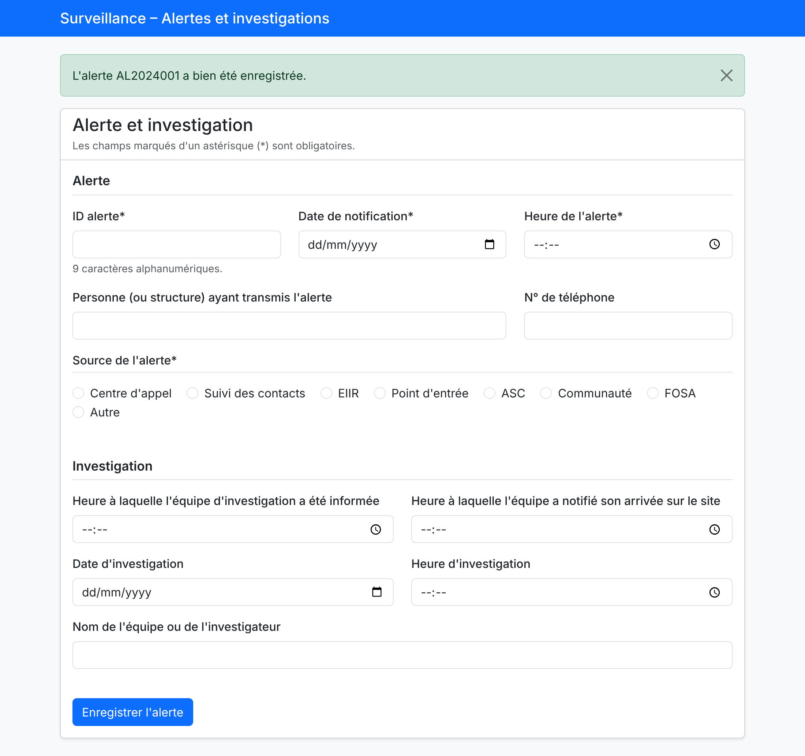

# formulaire


[](https://docs.astral.sh/ruff/)
[](LICENSE)

Ce dépôt réunit **deux projets indépendants**, chacun dans son dossier, avec sa documentation, ses dépendances et ses tests :

| Projet | Description | Technologies |
|---|---|---|
| [**Formulaire d'alerte et d'investigation**](formulaire-alerte/) | Application web de saisie des alertes sanitaires et de leur investigation : validation des données, administration, 23 tests automatisés | Python, Django 5.2, Bootstrap 5, django-crispy-forms |
| [**Détection de maladies des plantes**](classification-plantvillage/) | Notebook comparant InceptionV3 et MobileNetV2 pour classer les images PlantVillage (15 classes). Apprentissage par transfert en deux phases, évaluation sur un jeu de test indépendant | Python, TensorFlow / Keras, scikit-learn, Google Colab |

<p align="center">
  
</p>

## Démarrage rapide

**Application Django** (Python 3.12 ou plus récent) :

```bash
cd formulaire-alerte && python -m venv .venv && source .venv/bin/activate
```

```bash
pip install -r requirements.txt && python manage.py migrate && python manage.py runserver
```

Puis ouvrez <http://127.0.0.1:8000/>. Les détails sont dans [formulaire-alerte/README.md](formulaire-alerte/README.md).

**Notebook** : ouvrez-le dans Google Colab avec le badge de [classification-plantvillage/README.md](classification-plantvillage/README.md), choisissez un GPU, puis lancez *Tout exécuter*.

## Organisation du dépôt

```
.
├── formulaire-alerte/            # projet Django (config/ et application alerte_investigation/)
├── classification-plantvillage/  # notebook, dépendances et jeu de test synthétique
├── .github/workflows/ci.yml      # intégration continue
├── pyproject.toml                # configuration de ruff (lint et formatage)
└── CHANGELOG.md                  # historique des versions
```

## Qualité

Le workflow d'intégration continue ([GitHub Actions](.github/workflows/ci.yml)) se lance depuis l'onglet *Actions* du dépôt. Il exécute trois tâches :

1. **Lint et formatage** de tout le code Python, notebook compris, avec [ruff](https://docs.astral.sh/ruff/).
2. **Projet Django**, sous Python 3.12 et 3.13 :
   - `manage.py check` ;
   - vérification que les migrations sont à jour ;
   - les 23 tests.
3. **Notebook** : exécution complète avec [papermill](https://papermill.readthedocs.io/) sur un jeu d'images synthétiques. Ce test vérifie le pipeline, pas la performance du modèle.

Pour lancer les mêmes contrôles en local :

```bash
pip install ruff && ruff check . && ruff format --check .
```

```bash
cd formulaire-alerte && python manage.py test
```

## Historique

Les évolutions du dépôt sont décrites dans [CHANGELOG.md](CHANGELOG.md).

## Licence

Ce code est distribué sous licence [MIT](LICENSE).
