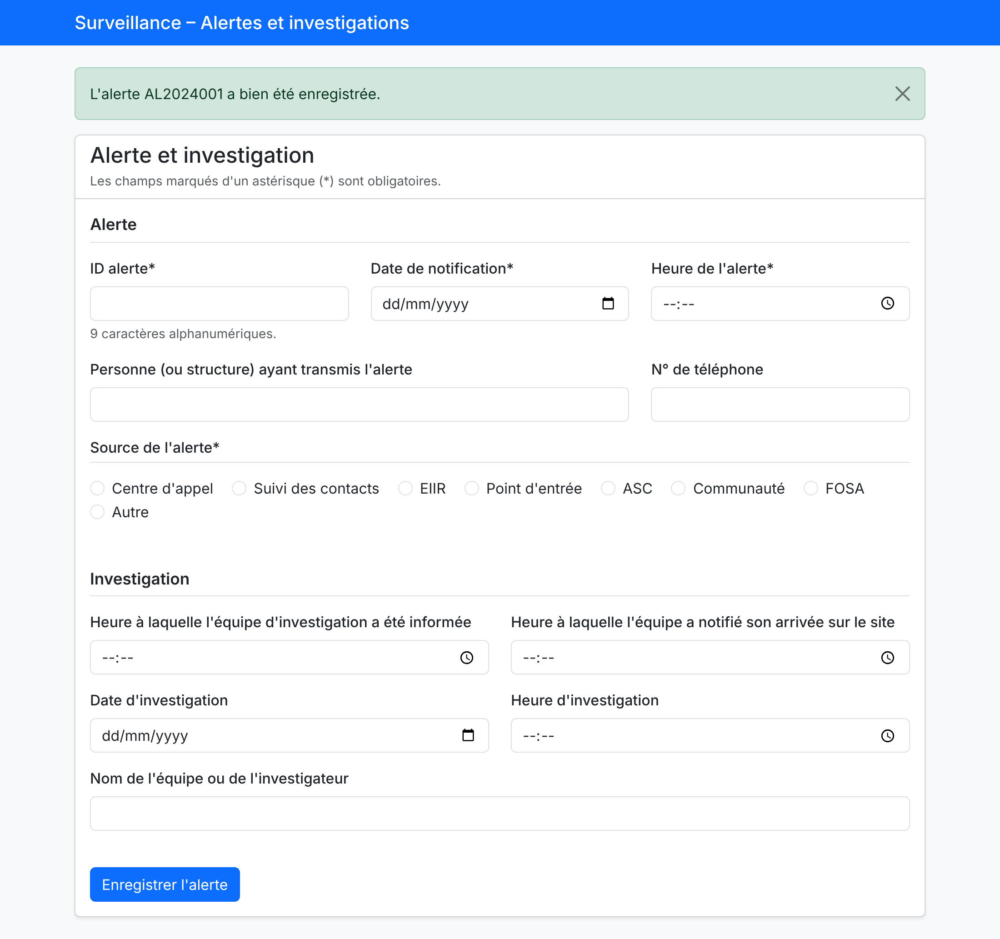

# Formulaire d'alerte et d'investigation (Django)

Cette application web sert à saisir les **alertes sanitaires** reçues par une équipe de surveillance et le **suivi de leur investigation** sur le terrain. Pour chaque alerte, elle enregistre :
- la source de l'alerte ;
- les horaires de l'alerte et de l'intervention ;
- l'équipe chargée de l'investigation.

Les données sont contrôlées, puis enregistrées en base. Elles se consultent dans l'interface d'administration de Django.



## Fonctionnalités

- **Formulaire en deux sections**, *Alerte* et *Investigation*, construit avec Bootstrap 5 et [django-crispy-forms](https://github.com/django-crispy-forms/django-crispy-forms).
- **Validation côté serveur.** Chaque erreur est signalée sous le champ concerné :
  - l'identifiant doit compter exactement 9 caractères alphanumériques et être unique ;
  - le numéro de téléphone doit compter de 7 à 15 chiffres (séparateurs `+ . - ( )` et espaces autorisés) ;
  - la date d'investigation ne peut pas précéder la date de notification ;
  - une précision est obligatoire lorsque la source est « Autre ».
- **Contrainte en base** (`CheckConstraint`) sur la cohérence des dates : elle protège aussi les données insérées sans passer par le formulaire.
- **Champ « Précision » affiché seulement si la source est « Autre »**, par un script JavaScript sans dépendance. Sans JavaScript, le champ reste visible et le formulaire fonctionne normalement.
- **Comportement après l'envoi** : le formulaire est vidé et un message de confirmation s'affiche. Recharger la page ne renvoie pas le formulaire (redirection après enregistrement, motif *Post/Redirect/Get*).
- **Administration** : liste filtrable par source et par date, recherche, navigation par date.

## Données saisies

| Champ | Obligatoire | Règle |
|---|:---:|---|
| `identifiant_alerte` | oui | 9 caractères alphanumériques, unique |
| `date_notification`, `heure_alerte` | oui | — |
| `personne_structure_transmis_alerte` | non | 255 caractères au maximum |
| `numero_telephone` | non | 7 à 15 chiffres |
| `source_alerte` | oui | Centre d'appel, Suivi des contacts, EIIR, Point d'entrée, ASC (agent de santé communautaire), Communauté, FOSA (formation sanitaire), Autre |
| `source_alerte_precision` | si « Autre » | 255 caractères au maximum |
| `heure_information_equipe`, `heure_arrivee_site` | non | — |
| `date_investigation`, `heure_investigation` | non | date d'investigation postérieure ou égale à la date de notification |
| `nom_equipe_investigateur` | non | 255 caractères au maximum |
| `cree_le` | automatique | horodatage de l'enregistrement |

Les champs de la partie *Investigation* sont facultatifs : une alerte peut être enregistrée avant le début de l'investigation.

## Installation et lancement

Prérequis : Python 3.12 ou 3.13.

```bash
cd formulaire-alerte
```

```bash
python -m venv .venv
```

```bash
source .venv/bin/activate
```

Sous Windows, la commande d'activation est `.venv\Scripts\activate`.

```bash
pip install -r requirements.txt
```

```bash
python manage.py migrate
```

```bash
python manage.py createsuperuser
```

```bash
python manage.py runserver
```

- Le formulaire est accessible à l'adresse <http://127.0.0.1:8000/>.
- L'administration est accessible à l'adresse <http://127.0.0.1:8000/admin/>, avec le compte créé par `createsuperuser`.

## Tests

```bash
python manage.py test
```

La suite compte 23 tests :
- **modèle** : règles de validation, contrainte en base, unicité de l'identifiant ;
- **formulaire** : les 8 sources, les champs obligatoires, la cohérence des dates, le téléphone ;
- **vues** : affichage, enregistrement puis redirection, données invalides sans erreur serveur, HTML bien formé ;
- **administration**.

Ils s'exécutent automatiquement dans GitHub Actions, sous Python 3.12 et 3.13 (voir [`../.github/workflows/ci.yml`](../.github/workflows/ci.yml)).

## Configuration

Les réglages propres à chaque déploiement sont lus dans des variables d'environnement ([`config/settings.py`](config/settings.py)). Sans aucune variable définie, l'application démarre en mode développement.

| Variable | Valeur par défaut | Rôle |
|---|---|---|
| `DJANGO_DEBUG` | `1` | Mettre `0` en production |
| `DJANGO_SECRET_KEY` | clé de développement | **Obligatoire** si `DJANGO_DEBUG=0` |
| `DJANGO_ALLOWED_HOSTS` | `localhost,127.0.0.1` en développement | Noms d'hôte autorisés, séparés par des virgules |
| `DJANGO_CSRF_TRUSTED_ORIGINS` | — | Origines HTTPS de confiance, par exemple `https://exemple.org` |
| `DJANGO_TIME_ZONE` | `UTC` | Fuseau horaire IANA, par exemple `Europe/Paris` |
| `DJANGO_SECURE_SSL_REDIRECT` | `0` | `1` pour rediriger tout le trafic vers HTTPS |
| `DJANGO_SECURE_HSTS_SECONDS` | `0` | Durée HSTS en secondes, une fois HTTPS en place |
| `DJANGO_BEHIND_HTTPS_PROXY` | — | `1` si un proxy inverse termine la connexion TLS |

Avant une mise en production, vérifiez la configuration avec :

```bash
python manage.py check --deploy
```

## Architecture

```
formulaire-alerte/
├── manage.py
├── requirements.txt
├── config/                      # projet Django : réglages, routes, WSGI/ASGI
└── alerte_investigation/        # application
    ├── models.py                # AlerteInvestigation, SourceAlerte, validateurs
    ├── forms.py                 # ModelForm et mise en page crispy-forms
    ├── views.py                 # saisie (Post/Redirect/Get)
    ├── admin.py
    ├── migrations/
    ├── templates/alerte_investigation/
    ├── static/alerte_investigation/{css,js}/
    └── tests/
```

## Limites connues

- **Formulaire public.** La saisie ne demande pas de connexion ; seule l'administration est protégée. Pour un usage réel avec des données de santé, il faut restreindre l'accès (par exemple avec `login_required` et des groupes d'utilisateurs) et choisir un hébergement conforme à la réglementation applicable.
- **Base SQLite.** Elle convient au développement et à de petits volumes. Pour plusieurs utilisateurs simultanés, PostgreSQL est préférable.
- **Bootstrap chargé depuis un CDN** (jsDelivr), avec contrôle d'intégrité (SRI). Le style ne s'affiche donc pas sans connexion à Internet.
